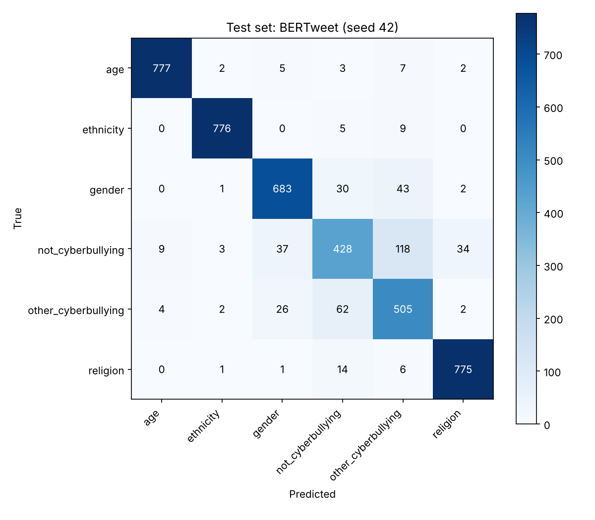
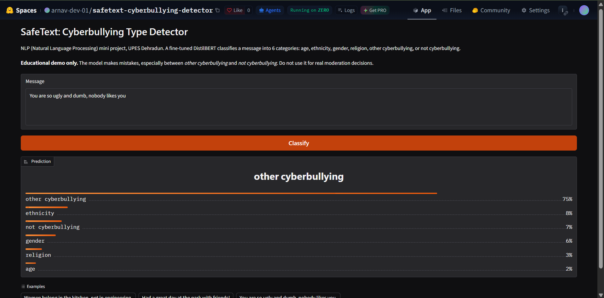

# Cyberbullying Type Classification on Tweets

Multiclass NLP (Natural Language Processing) mini project: classify a tweet into the **type** of cyberbullying it contains, using classical machine learning, deep learning and fine-tuned transformer models.

**Live demo:** [Hugging Face Space](https://huggingface.co/spaces/arnav-dev-01/safetext-cyberbullying-detector) &nbsp;|&nbsp; **Model weights:** [Hugging Face model page](MODEL_LINK)

> **Content warning:** the dataset contains real tweets with slurs, insults and other offensive language. Examples shown in this repository are quoted for analysis only.

## Team

| Name | Roll number |
|---|---|
| Abheeshek Sinha | R2142235190 |
| Arnav Patel | R2142231597 |
| Amit Singh | R2142232091 |
| Yash Aggarwal | R2142231601 |
| Shashwat Kashyap | R2142231570 |

**Subject:** Natural Language Processing (Experiment 9, Multiclassification NLP Task)
**Faculty:** Dr. Sahinur Rahman Laskar
**Institution:** University of Petroleum and Energy Studies (UPES), Dehradun

---

## 1. Overview

Online platforms need to flag harmful posts and also understand *who* is being targeted. This project builds and compares models that read a single tweet and predict one of six labels:

`age`, `ethnicity`, `gender`, `religion`, `other_cyberbullying`, `not_cyberbullying`

We compare four groups of models under identical data splits and report macro-F1 (the average of per-class F1, so every class counts equally) as the main metric:

| Group | Models |
|---|---|
| A. Classical (word TF-IDF) | Logistic Regression, Naive Bayes, Linear SVM, Random Forest, XGBoost, Voting ensemble |
| B. Classical (word + character TF-IDF) | Logistic Regression, Naive Bayes, Linear SVM |
| C. Deep learning | BiLSTM with attention |
| D. Transformers | DistilBERT, BERT-base, RoBERTa-base, BERTweet |

**Main finding:** all four fine-tuned transformers reach about 0.89 test macro-F1 and are statistically close to each other. They beat the best classical model by about 1.2 points and the BiLSTM by about 2 points. A Linear SVM on word + character n-grams gets within about 1 point while training in seconds.

---

## 2. Dataset

- **Name:** Cyberbullying Classification (Kaggle, by andrewmvd)
- **Link:** https://www.kaggle.com/datasets/andrewmvd/cyberbullying-classification (see the page for the license and provenance)
- **File:** `cyberbullying_tweets.csv`, with columns `tweet_text` and `cyberbullying_type`
- **Size:** 47,692 tweets, six classes of roughly 7,800 to 8,000 tweets each (originally balanced)

The dataset is **not included in this repository**. Download it from Kaggle (see "How to run").

### Data after cleaning and de-duplication

| Step | Rows |
|---|---|
| Raw | 47,692 |
| After de-duplication (see below) | 43,711 |

| Class | Rows after cleaning |
|---|---|
| religion | 7,969 |
| age | 7,956 |
| ethnicity | 7,900 |
| gender | 7,589 |
| not_cyberbullying | 6,286 |
| other_cyberbullying | 6,011 |

`not_cyberbullying` and `other_cyberbullying` lost the most rows during de-duplication, so the classes are slightly uneven after cleaning. This is why macro-F1 is used.

### Splits

Stratified 80 / 10 / 10 split with a fixed random seed (42), so every team member gets identical data:

| Split | Rows |
|---|---|
| Train | 34,968 |
| Validation | 4,371 |
| Test | 4,372 |

The test set is used only for the final results. Models and the best epoch are selected on the validation set.

---

## 3. Preprocessing

1. Rename columns to `text` and `label`.
2. Clean each tweet: decode HTML entities, lowercase, remove URLs, remove `@mentions`, remove a leading `rt`, drop the `#` symbol but keep the hashtag word, collapse whitespace.
3. Drop tweets that became empty.
4. **De-duplicate:** 1,627 distinct texts appeared with conflicting labels, and all copies of them were removed. 387 further exact duplicates (same text, same label) were reduced to one copy. This prevents the same tweet from appearing in both train and test.
5. Stratified train / validation / test split.

Why de-duplicate: if a tweet appears in both train and test, the score is inflated because the model has already seen the answer.

---

## 4. Features and models

### Groups A and B: classical models on TF-IDF

TF-IDF (Term Frequency-Inverse Document Frequency) turns each tweet into a weighted word-count vector.

- **Word features (A):** unigrams and bigrams, `min_df=2`, sublinear term frequency.
- **Word + character features (B):** the word features plus character n-grams of length 2 to 5 (`char_wb`, `min_df=3`, up to 150,000 features). Character n-grams capture misspellings and disguised words that word features miss.

| Model | Settings |
|---|---|
| Logistic Regression | `C=3`, `max_iter=1000` |
| Naive Bayes (multinomial) | `alpha=0.1` |
| Linear SVM | `C=0.5` |
| Random Forest | 200 trees |
| XGBoost | 300 trees, depth 6, learning rate 0.1 (GPU) |
| Voting ensemble | hard majority vote of the five models above on word features; ties go to Logistic Regression |

### Group C: BiLSTM with attention

BiLSTM (Bidirectional Long Short-Term Memory) reads each tweet in both directions; an attention layer learns which words matter.

- Own tokenizer (words and punctuation), vocabulary of words seen at least twice, max length 60 tokens
- Embedding 200, hidden size 128 (bidirectional), dropout 0.4
- Adam, learning rate 2e-3, batch size 128, gradient clipping 1.0
- Up to 12 epochs with early stopping (patience 3) on validation macro-F1
- 3 seeds: 42, 7, 2024

### Group D: fine-tuned transformers

| Model | Hugging Face ID |
|---|---|
| DistilBERT | `distilbert-base-uncased` |
| BERT-base | `bert-base-uncased` |
| RoBERTa-base | `roberta-base` |
| BERTweet | `vinai/bertweet-base` |

- Max 96 tokens, dynamic padding
- 3 epochs, learning rate 2e-5, weight decay 0.01, 10% warmup, mixed precision (fp16)
- Per-device batch size 32 on 2 GPUs (effective batch size 64)
- Best epoch chosen on validation macro-F1
- 3 seeds: 42, 7, 2024

**Hardware:** Kaggle notebook with 2 x Tesla T4 GPUs. One run took about 8 minutes for DistilBERT and 16 to 17 minutes for BERT-base, RoBERTa-base and BERTweet.

---

## 5. Evaluation

- **Main metric:** macro-F1. Also reported: accuracy, macro-precision, macro-recall, per-class F1 and a confusion matrix.
- Neural models were trained with 3 seeds and are reported as mean ± standard deviation. Classical models are deterministic and were run once.
- A 4,372-tweet test set has roughly ±0.5 points of sampling error, so differences smaller than about 1 point should not be over-interpreted.

---

## 6. Results

### Test set (4,372 tweets)

| Group | Model | Runs | Macro-F1 | Accuracy | Macro-Precision | Macro-Recall | Val macro-F1 |
|---|---|---|---|---|---|---|---|
| D | RoBERTa-base | 3 | 0.8919 ± 0.0018 | 0.9026 | 0.8930 | 0.8927 | 0.8939 |
| D | BERTweet | 3 | 0.8917 ± 0.0013 | 0.9026 | 0.8926 | 0.8924 | 0.8987 |
| D | DistilBERT | 3 | 0.8896 ± 0.0037 | 0.9002 | 0.8900 | 0.8902 | 0.8930 |
| D | BERT-base | 3 | 0.8869 ± 0.0012 | 0.8979 | 0.8882 | 0.8877 | 0.8969 |
| B | Linear SVM (word+char) | 1 | 0.8801 | 0.8916 | 0.8804 | 0.8807 | 0.8753 |
| B | Logistic Regression (word+char) | 1 | 0.8756 | 0.8866 | 0.8761 | 0.8759 | 0.8786 |
| C | BiLSTM + attention | 3 | 0.8695 ± 0.0021 | 0.8813 | 0.8699 | 0.8696 | 0.8743 |
| A | Voting ensemble (word) | 1 | 0.8664 | 0.8801 | 0.8676 | 0.8675 | 0.8644 |
| A | Linear SVM (word) | 1 | 0.8652 | 0.8792 | 0.8660 | 0.8661 | 0.8646 |
| A | XGBoost (word) | 1 | 0.8626 | 0.8751 | 0.8694 | 0.8639 | 0.8637 |
| A | Logistic Regression (word) | 1 | 0.8622 | 0.8756 | 0.8624 | 0.8627 | 0.8630 |
| A | Random Forest (word) | 1 | 0.8425 | 0.8566 | 0.8493 | 0.8437 | 0.8518 |
| B | Naive Bayes (word+char) | 1 | 0.8038 | 0.8237 | 0.8119 | 0.8061 | 0.8006 |
| A | Naive Bayes (word) | 1 | 0.7665 | 0.7957 | 0.7823 | 0.7721 | 0.7700 |

Full numbers are in `results/final_comparison.csv` and `results/all_results.csv`.

### Reading the results

- **The four transformers are effectively tied** (0.887 to 0.892 on test, within the test set's sampling error). BERTweet was best on validation and RoBERTa-base was marginally best on test.
- **Transformers beat classical models by a small margin:** about 1.2 points over the best classical model (Linear SVM, word+char), 1.6 over Logistic Regression and 2.2 over the BiLSTM.
- **Character n-grams help:** Logistic Regression improved from 0.8630 to 0.8786 on validation when character n-grams were added.
- **The BiLSTM did not beat the character n-gram linear models**, and the voting ensemble did not beat its best member.
- **Cost trade-off:** the Linear SVM trains in about 4 seconds; a transformer run takes 8 to 17 minutes on two T4 GPUs.

### Per-class test F1 (mean over 3 seeds)

| Class | DistilBERT | BERT-base | RoBERTa-base | BERTweet |
|---|---|---|---|---|
| age | 0.978 | 0.978 | 0.980 | 0.981 |
| ethnicity | 0.985 | 0.986 | 0.987 | 0.983 |
| gender | 0.898 | 0.898 | 0.904 | 0.905 |
| not_cyberbullying | 0.735 | 0.727 | 0.736 | 0.737 |
| other_cyberbullying | 0.784 | 0.776 | 0.787 | 0.783 |
| religion | 0.958 | 0.956 | 0.957 | 0.961 |

### Confusion matrix (BERTweet, seed 42, test set)



---

## 7. Error analysis

BERTweet (seed 42) made 428 errors on 4,372 test tweets (accuracy 0.902). The most common mistakes:

| True class | Predicted class | Count |
|---|---|---|
| not_cyberbullying | other_cyberbullying | 118 |
| other_cyberbullying | not_cyberbullying | 62 |
| gender | other_cyberbullying | 43 |
| not_cyberbullying | gender | 37 |
| not_cyberbullying | religion | 34 |
| gender | not_cyberbullying | 30 |

- **Age, ethnicity and religion are almost solved** (F1 0.96 to 0.99). **Gender** is good (0.90). The difficult classes are `not_cyberbullying` (F1 about 0.73) and `other_cyberbullying` (about 0.78).
- **All four transformers show the same per-class pattern** (differences of about 0.01), which suggests the limit comes from the data, not the model.
- **192 test tweets (4.4%) were misclassified by all 12 transformer runs.** Many of these look like questionable or context-dependent labels, for example a polite "thank you for the kind words :)" labelled `other_cyberbullying`, and a news-style tweet labelled `not_cyberbullying`. These appear to be label noise or tweets that need the surrounding conversation to interpret.
- Several `gender` mistakes are tweets about a TV show (the `#mkr` hashtag), which hints at topic-specific patterns in the data.

---

## 8. Limitations

- **Label noise:** the same tweets sometimes appear under different labels (1,627 conflicting texts were found and removed), and some remaining labels look doubtful. This limits the achievable score.
- **Possible source or topic shortcuts:** the classes may come from different source collections, so models can partly learn writing style or topic instead of the meaning of the bullying.
- **Single tweets without context:** replies and quoted conversations are ambiguous when read in isolation.
- **One dataset, English only.**
- **Test-set size:** differences below about 1 point between models are within sampling error.
- **Not for automated punishment:** predictions are noisy and should support human moderators, not replace them.

---

## 9. How to run

The experiments were run in a Kaggle notebook.

1. Create a new Kaggle notebook and click **Add Input**, then search for **Cyberbullying Classification** (by andrewmvd).
2. In the notebook settings, turn on a **GPU accelerator** (we used 2 x T4) and turn on **Internet** (needed to download the pretrained models).
3. Upload or open `notebooks/cyberbullying_classification.ipynb` and run the cells in order:
   1. Setup and environment check
   2. Load and inspect the data
   3. Clean text, remove duplicates, create the 80/10/10 split (seed 42)
   4. Evaluation helper
   5. Classical models (groups A and B) and the voting ensemble
   6. BiLSTM with attention (3 seeds)
   7. Transformers (3 seeds each)
   8. Test-set scoring, final tables, confusion matrix and error analysis

To run locally instead, install the libraries below and change the data path in the loading cell:

```bash
pip install -r requirements.txt
```

Tested on Kaggle with Python 3.13, PyTorch 2.11 and transformers 5.20.

**Reproducibility notes:** the data split uses `random_state=42`. Neural models use seeds 42, 7 and 2024. GPU training is not perfectly deterministic, so a re-run may differ in the third or fourth decimal.

---

## 10. Repository structure

```
.
├── README.md
├── notebooks/
│   └── cyberbullying_classification.ipynb   # full pipeline (data -> models -> evaluation)
├── results/
│   ├── final_comparison.csv                 # validation and test summary per model
│   ├── all_results.csv                      # every run, every metric
│   └── preds/                               # saved transformer predictions (val and test)
├── figures/
│   ├── confusion_matrix_bertweet_test.png
│   └── demo_screenshot.png
├── app/
│   ├── website/                             # full FastAPI website (runs locally)
│   │   ├── main.py
│   │   ├── requirements.txt
│   │   └── static/                          # index.html, style.css, script.js
│   └── space/                               # Gradio demo deployed on Hugging Face
│       ├── app.py
│       └── requirements.txt
├── requirements.txt                         # libraries for the notebook
├── .gitignore
└── LICENSE
```

Not included: the raw dataset (download from Kaggle) and the trained model weights (about 270 MB for DistilBERT, too large for a normal GitHub file). The saved DistilBERT classifier is available on Hugging Face: [model page](MODEL_LINK).

---

## 11. Web demo

The deployed model is the fine-tuned DistilBERT. DistilBERT was chosen for the demo because it is smaller (about 270 MB versus 440 to 540 MB for the others) and trains in about half the time, at a cost of about 0.2 points of macro-F1 on the test set compared with the best transformers.

**Online demo:** https://huggingface.co/spaces/arnav-dev-01/safetext-cyberbullying-detector



The online demo (`app/space/`) is a small Gradio app. The first request after the Space has been idle can take up to a minute while it wakes up. It is an educational demo and must not be used for real moderation decisions.

### Run the full website locally

`app/website/` is a FastAPI app serving a project website (background on cyberbullying, project overview, interactive results chart and a live classifier).

1. Download the four model files (`config.json`, `model.safetensors`, `tokenizer.json`, `tokenizer_config.json`) from the [model page](MODEL_LINK) into `app/website/model/`.
2. From inside `app/website/`:

```bash
python -m venv venv
venv\Scripts\activate          # on macOS/Linux: source venv/bin/activate
pip install -r requirements.txt
uvicorn main:app
```

3. Open http://127.0.0.1:8000.

The app applies the same text cleaning as training before predicting. Use `transformers` 5.x, the version the model was saved with.

---

## 12. Future scope

- **Clean the labels:** re-annotate the doubtful tweets, or use the 192 tweets that every model got wrong to guide a label audit.
- **Two-stage detector:** first decide whether a tweet is cyberbullying at all, then decide the type. This separates the hardest decision from the easy ones.
- **Add conversation context** (the tweet being replied to).
- **Hinglish and multilingual data:** extend to Hindi-English code-mixed text using models such as MuRIL.
- **Explainability:** highlight the words that drive each prediction (for example with LIME or attention weights).
- **Ensembling transformers** and checking significance with paired tests.

---

## 13. License

Released under the MIT License (see `LICENSE`). The dataset and the pretrained models keep their own licenses; see their pages.

---

## 14. References

- Dataset: *Cyberbullying Classification*, Kaggle (andrewmvd).
- Devlin et al., *BERT: Pre-training of Deep Bidirectional Transformers for Language Understanding*, 2019 (arXiv:1810.04805).
- Liu et al., *RoBERTa: A Robustly Optimized BERT Pretraining Approach*, 2019 (arXiv:1907.11692).
- Sanh et al., *DistilBERT, a distilled version of BERT*, 2019 (arXiv:1910.01108).
- Nguyen et al., *BERTweet: A pre-trained language model for English Tweets*, 2020 (arXiv:2005.10200).
- Hugging Face Transformers and scikit-learn libraries.
